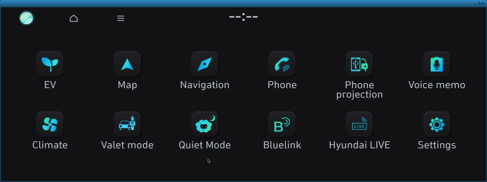
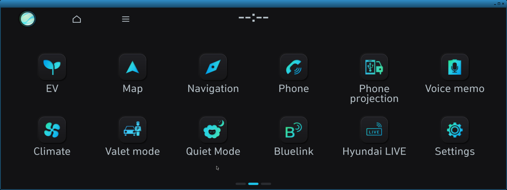

# IONIQ 5 (LG Gen5W) infotainment research

Reverse-engineering notes and tooling for the 2021 IONIQ 5 head unit, with the
goal of **running the authentic vendor firmware — unmodified — inside an isolated
QEMU VM**.

This is research documentation. It is not a jailbreak guide and does not describe
how to modify a vehicle.

## Where the project is right now

The VM boots the genuine vendor kernel and the genuine recovered userspace, and
reaches the real Hyundai home screen. Navigation is the open problem.

| Area | State | Notes |
| --- | --- | --- |
| Vendor kernel boot | **Working** | Gen5W kernel boots under QEMU with a documented ABL boot-parameter adaptation. Anti-tamper is satisfied inside the VM. |
| Recovered rootfs / userspace | **Working** | EU 2026-01-28 image decrypted offline and mounted read-only. |
| Launcher: standby → profile confirm | **Working** | Authentic driver-selection and safety-notice screen. |
| Launcher: Home screen | **Working** | Authentic `AppHomeScreen` with real tile grid. |
| AppNavi (navigation) | **Partial** | Process starts, initialises, and renders genuine map pixels into its own surface. |
| Home ↔ Navigation compositing | **Blocked** | AppNavi never becomes the foreground window; Home stays visible. See below. |
| Audio | Not started | Needs C-TRACS/audio service contracts. |
| CAN / MICOM | Partial | Local D-Bus simulation exists; real contract still being reconstructed. |
| Persistence, restart/suspend | Not started | Needs evidence-derived storage and power contracts. |
| Input (touch/keys) | Partial | Wayland input harness exists; not wired end to end. |

Everything above is measured by snapshot runs — the disk image is never written
to, and the base rootfs hash is rechecked after each experiment
(`4953a005…6d036f`).

## Screenshots

All frames are Wayland framebuffer captures from the running VM, at the head
unit's real 1920×720 geometry.

### 1. Profile / confirm screen


Produced by the genuine launcher, not a mock-up. Driver 1 / Driver 2 / Guest
selection with the real safety notice and Confirm / Language buttons.

### 2. Authentic Home screen



The real `AppHomeScreen`: EV, Map, Navigation, Phone, Phone projection, Voice
memo, Climate, Valet mode, Quiet Mode, Bluelink, Hyundai LIVE, Settings — with
the genuine top bar (profile orb, home, menu).

### 3. Attempted navigation, still showing Home



The honest failure case. This frame was captured during the navigation window.
Only the page-indicator dots changed; Home remains composed. This is the visible
symptom of the ApplicationManager state problem described below.

### 4. Genuine AppNavi map pixels


Rendered by the authentic AppNavi binary into surface `3000`: real road network,
river, and the red position arrow. The map surface only occupies part of the
width, so the right-hand region is empty.

## Why Navigation does not appear yet

This is the current focus, and it is a contract problem rather than a rendering
problem. Recovered from disassembly plus runtime traces:

- AppNavi calls launcher `launched(30)`, then separately emits
  `SendNaviBootFail(5)` on `/navigation_map`. The `5` is a hard-coded literal, not
  derived from an engine result.
- ApplicationManager caches that status, but gates downstream handling on a
  *separate* window byte. That byte stays `0`, so the manager returns to
  `11/11` instead of settling in `APP_NAVI` (`30`).
- Only a **background** (BG) window notification updates that byte, and the
  observed runtime only delivers **foreground** (FG).
- The compositor rule is now known: **any positive width or height selects FG**;
  BG requires both dimensions non-positive. So "fixing" geometry from 1926×753 to
  1920×720 would not change the outcome.
- The BG path is not hypothetical: positive Camera/Standby controls were observed
  driving `1926×753 → 0×0 → BG → slotNotifyBGInfo`.

Open question: does AppNavi's genuine Qt `hide()`/null-buffer attach ever occur in
this stack, and can the VM legitimately produce the BG notification?

Deliberate non-actions: the status is not patched, the window flag is not forced,
and no success callback is synthesised.

## Running it

VM control lives in `tools/uk_fw/vm_boot.py`; boot-contract details are in
`evidence/`. The working configuration:

- QEMU with TCG acceleration
- CPU `max,vendor=GenuineIntel`
- 1536 MiB RAM
- disk `snapshot=on`
- **no NIC**

Snapshot mode with no networking is a hard requirement: runs must not mutate the
base image or reach the network.

## Validation

```sh
python3 tests/run_all.py        # integrated read-only harness
python3 -m unittest discover -s tests
```

The harness checks the research ledger, artifact hashes, JSON validity, Council
packets, privacy rules and documentation scope. In public mode it inspects only
Git-indexed files.

## Project records

| File | Purpose |
| --- | --- |
| `HANDOVER.md` | Current checkpoint and next bounded task |
| `Ioniq5-CHANGELOG.md` | Editable, newest-first summary |
| `Ioniq5-HISTORY.md` | **Append-only** research history; corrections are appended, never rewritten |
| `Ioniq5-research-plan.md` | Scope, confidentiality and non-actuation boundaries |
| `evidence/` | Source-labelled findings with provenance |
| `PUBLIC-RELEASE.md` | What this public tree excludes, and the publication gate |

## Scope and confidentiality

This repository contains sanitised research findings only. Raw vehicle exports,
decrypted firmware, full core dumps, driving traces and third-party paper
artifacts are deliberately excluded and remain in a private archive. See
`PUBLIC-RELEASE.md` for the exact exclusion list and the conditions that must be
met before the repository is made public.

Security findings that could affect real vehicles are tracked in a separate
register outside this public tree and are handled under coordinated-disclosure
rules.

## Latest bring-up — 2026-10-31

State after a long session working the VM end to end. Everything below was measured, not assumed; the
scaffold and its hand-off notes live in `tools/uk_fw/ias_backend_soft/`.

### What now works

- **Authentic boot chain**: `init=/lib/systemd/esinit` reaches `Reached target Multi-User System`. Two vendor
  defects had to be worked around in a copy-on-write clone and both are recorded: `check-mount.sh` ships mode
  `0644` (no execute bit) and eleven `fstab` entries demand `mmcblk0pN` partitions the projection lacks.
- **Our own Weston backend** (`ias-backend-soft.so`): the vendor `weston` runs it with `ias-shell.so`, publishes
  `ias_crtc`/`ias_mode`, and `wrandr` reports `CRTC = 1, 1920x720 @ 60000`. The shipped compositor is
  **LG-patched**: `struct weston_output` differs from upstream 1.10 by `0x18` bytes, so a plugin built against
  upstream headers initialises fields in the wrong place and crashes it — `vendor-abi.patch` restores the layout.
- **EGL**: the image ships **no software rasteriser**, only Intel DRI. Injecting Debian `swrast_dri.so` with
  `libLLVM-3.9` and setting `LIBGL_DRIVERS_PATH`/`MESA_LOADER_DRIVER_OVERRIDE=swrast` is what makes GL work.
- **Frame capture**: a `weston_screenshooter` client plus a backend framebuffer dump. `--use-pixman` is
  mandatory, because the default renderer cannot read pixels back.
- **MICOM adaptors**: `micom-responder` provides the `/dev/ttyS1` peer (the guest is missing `/dev/pts`, so it
  runs on a pty) and `micom-service` owns `com.lge.car.micom` on the session-independent system bus. With them,
  the launcher reaches readiness for the first time:

  ```
  [  OK  ] Started HKMC Preminum AVN 2.1 -Launcher.
  micom-svc: AskSysBootinfo -> 35 bytes
  ApplicationLauncher::getAppProcessByAppId appId[2][ApplicationManager]
  ```

### What is still blocked, and why

The launcher registers and begins dispatching, then loops on `appId[2][ApplicationManager]` because
`ApplicationManager` cannot initialise boot information — it reports `initMicomShareMem() -> pszSrc NULL`.
Seven environmental hypotheses have been excluded by measurement (bus reachability, interface construction,
file-backed segments, peer presence, payload content, `/dev/shm`, segment existence). What remains is the
**layout and validity rules of the MICOM status structure**, which is disassembly work on a stripped binary.
Register entry **V-036** records this, with the elimination list and the anchors.

Because the client commits surfaces but never attaches a buffer, the HMI frame itself is black. That is
recorded honestly rather than cropped out — the control image is the evidence that the compositor renders.

| Compositor control (`weston-simple-shm`) | Current HMI frame |
| --- | --- |
|  |  |
| Test pattern rendered by the vendor compositor through our backend — **173 distinct colours**, proving the whole path from backend to framebuffer works. | `AppHomeScreen` running with its surfaces mapped: uniformly black because no buffer is ever attached. `initMicomShareMem() -> pszSrc NULL` is why the launcher's dispatch never completes. |

Both frames are 240×90 downscaled dumps of the backend framebuffer, moved out of the guest over a
`-chardev file` serial port (console transfer corrupts above roughly 8 KB).
